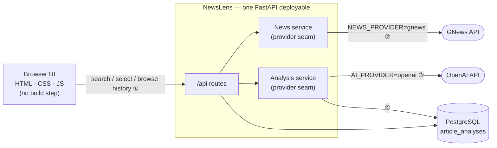

# NewsLens

Search recent news, select an article to get an AI-generated summary and
sentiment, and revisit everything that's ever been analysed via History.
See `newslens-feature-spec.md` for the full product/API specification this
was built against.

## Quick start (local)

```bash
cp .env.example .env
# then edit .env: supply real GNEWS_API_KEY and OPENAI_API_KEY

docker compose up --build -d
docker compose ps
docker compose logs -f app
```

Open **http://localhost:8000/**. Interactive API docs (Swagger UI) are at
**http://localhost:8000/docs**.

```bash
docker compose down      # stops the stack, keeps saved data
docker compose down -v   # destructive: also deletes the database volume
```

## Environment variables

All of these are **required** — there are no in-code defaults. `.env.example`
documents a working value for each; `app/config.py` fails fast with a clear
error at startup if any is missing.

| Variable | Purpose |
| --- | --- |
| `NEWS_PROVIDER` | Selects the implementation in `app/services/news/` (currently `gnews`) |
| `GNEWS_API_KEY` | Your GNews API key |
| `GNEWS_BASE_URL` | GNews search endpoint (operational config, not a code constant) |
| `AI_PROVIDER` | Selects the implementation in `app/services/analysis/` (currently `openai`) |
| `OPENAI_API_KEY` | Your OpenAI API key |
| `OPENAI_MODEL` | Model identifier your key's project actually has access to — verify with `client.models.list()` before assuming a default like `gpt-4o-mini` works |
| `DATABASE_URL` | SQLAlchemy connection string; `db` is the Compose service hostname |

## Database

One table, `article_analyses` (see `app/models.py` / spec §7). Schema is
created automatically on startup via SQLAlchemy's `create_all()` — there is
no migration framework for this single-table schema. Data lives in the
named Docker volume `aries_db_data` and survives `docker compose down`
(without `-v`) and container rebuilds.

## Running tests

```bash
docker compose run --rm app pytest -q
```

GNews and OpenAI are always mocked — no test run ever consumes real API
credits. Tests target an isolated `newslens_test` database, created
automatically; they never touch the database your `.env` points the app
itself at.

- `tests/integration/` — real Postgres, mocked providers. Exercises our own
  persistence and constraint/race-handling logic (the unique-URL dedup
  recovery in particular), which is exactly the kind of thing that
  shouldn't be mocked away.
- `tests/unit/` — no database, no network at all. Pure logic: OpenAI
  response parsing, output validation, and SDK-exception-to-HTTP-error
  mapping.

## API

Base path `/api`, JSON throughout, UTC timestamps with a literal `Z` suffix.

| Method & path | Purpose |
| --- | --- |
| `GET /api/articles?query=...` | Search recent news (1–200 char query); normalised results include an `analysis_id` hint for already-saved articles. Never calls the AI provider. |
| `POST /api/analyses` | Submit an article snapshot; returns the saved analysis (`201` if newly generated, `200` if it already existed — same resource shape either way). |
| `GET /api/analyses` | History: all saved analyses, newest first, capped at 100 rows. Never calls GNews or OpenAI. |
| `GET /api/analyses/{id}` | Fetch one saved analysis by id, or `404`. |

```bash
curl "http://localhost:8000/api/articles?query=artificial+intelligence"
```

## Architecture



One deployable, same origin for API and UI. `NewsSvc`/`AnalysisSvc` each
dispatch to a provider module picked at runtime by an env var — adding a
provider is one new module + one dict entry, no interfaces or DI
container. A `POST` checks the database before calling OpenAI, releases
the read transaction first, then inserts in a short write transaction;
a concurrent insert recovers into the winning row via its unique
constraint instead of erroring.

**Known limitations, briefly** (circled numbers above):

- **①** No authentication — the demo is intentionally public; mitigate
  cost exposure via provider-side spend caps, not a login.
- **②** GNews free tier: truncated content, occasional near-duplicate
  URLs for the same story, shared daily quota.
- **③** Concurrent duplicate inference is possible for a brand-new URL
  (two simultaneous first requests can both call OpenAI); only one
  result is ever persisted. No distributed locking.
- **④** `article_url` is the identity, used verbatim (no
  canonicalisation); History is capped at 100 rows (a quiet safety
  limit, not pagination); a submitted snapshot isn't independently
  re-verified server-side.

## AI assistance disclosure

This project — specification review, implementation, tests, and this
README — was built collaboratively with Claude (Anthropic) under direct
human review throughout. The git history reflects the actual incremental,
reviewed build process: see commit messages for what was verified at each
step and why specific design decisions were made.
